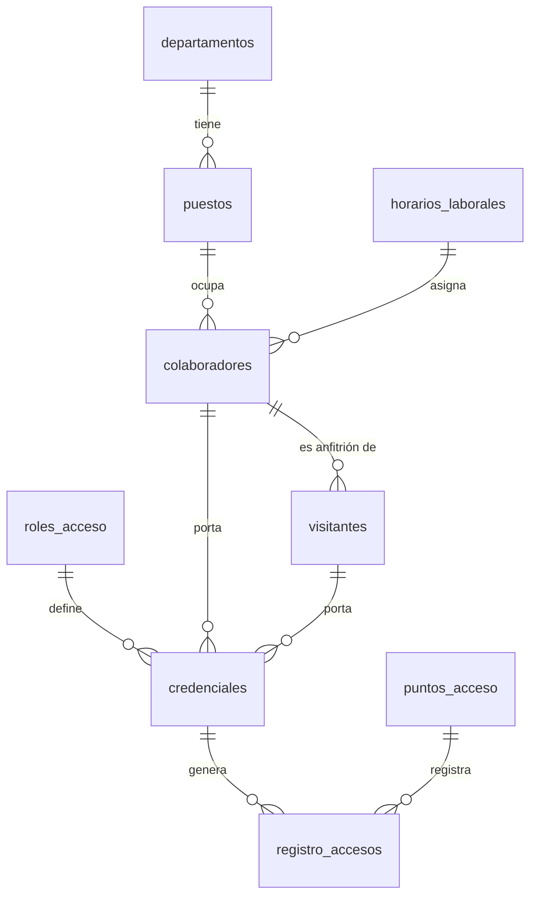

# Sistema de Control de Acceso con Códigos QR – Grupo Solutions

Base de datos en **PostgreSQL** para el control de entradas y salidas de un edificio mediante credenciales con código QR.
Proyecto de la materia **Taller de Bases de Datos** del Instituto Tecnológico de Villahermosa (TecNM).

**Docente:** José Juan Ulin Ricárdez · **Equipo 6 – Color Magenta**

- Alfonso De La Cruz Emily
- Almeida Sánchez Jesús Alejandro
- Bocanegra García Héctor Manuel
- García Rubalcabar José de Jesús
- Pérez Metelín Estrella

---

## ¿De qué trata?

**Grupo Solutions** es una empresa (caso de estudio) de servicios administrativos y tecnológicos con oficinas en Villahermosa, Tabasco. Cada colaborador, contratista o visitante recibe una credencial con un código QR que se escanea en los lectores de las puertas del edificio. Cada escaneo queda registrado en una bitácora.

## ¿Qué busca lograr?

- **Saber quién entra y sale** del edificio, con qué credencial, por qué punto de acceso y a qué hora.
- **Distinguir personal interno de visitantes**: los colaboradores tienen puesto, departamento y turno; los visitantes, motivo de visita y un colaborador anfitrión.
- **Controlar la vigencia de las credenciales**: rol de acceso, fechas de emisión y vigencia, y estado (activa, vencida o revocada).
- **Conservar la trazabilidad**: las bajas del personal son lógicas (`activo = FALSE`); los registros nunca se borran.
- **Generar información para decidir**: afluencia por día, tiempo de permanencia, credenciales sin uso y puntos con más tráfico.
- **Proteger la información** con usuarios, roles y privilegios bajo el principio de mínimo privilegio.

## Modelo relacional (9 tablas en 3FN)



| Tabla | Qué guarda | Filas |
|---|---|---|
| `departamentos` | Áreas de la empresa y su ubicación física | 6 |
| `roles_acceso` | Niveles de permiso de las credenciales | 4 |
| `horarios_laborales` | Turnos matutino, vespertino y administrativo | 3 |
| `puntos_acceso` | Lectores QR / puertas del edificio | 4 |
| `puestos` | Puestos de trabajo, ligados a un departamento | 9 |
| `colaboradores` | Empleados y contratistas, con baja lógica | 10 |
| `visitantes` | Personas externas con motivo de visita y anfitrión | 5 |
| `credenciales` | Códigos QR de un colaborador **o** de un visitante, nunca de ambos | 15 |
| `registro_accesos` | Bitácora de entradas y salidas | 23 |

**Decisiones de diseño:**

- El departamento de un colaborador se obtiene por la cadena `colaboradores → puestos → departamentos`, sin repetir datos.
- Colaboradores y visitantes van en tablas separadas porque tienen atributos distintos.
- Un `CHECK` de exclusividad en `credenciales` garantiza un único titular por QR.
- `ON DELETE CASCADE` solo en `registro_accesos` hacia `credenciales`.

## Aplicación de escritorio (modelo v2)

La carpeta [`control_acceso_qr/`](control_acceso_qr/) contiene la **aplicación de escritorio en Python (PyQt6)** con lector QR por cámara web. Usa el **modelo v2 de 18 tablas** (base `grupo_solutions_v2`), que evoluciona el modelo de 9 tablas de las actividades.

En su [README](control_acceso_qr/README.md) están la instalación, las cuentas de demostración y la arquitectura en capas.

## Estructura del repositorio

```
sql/                           Modelo v1 (9 tablas) – actividades de la materia
├── 00_crear_base.sql          Crea la base grupo_solutions
├── 01_tablas.sql              9 tablas, restricciones e índices
├── 02_datos.sql               Datos de prueba y verificación de la carga
├── 03_consultas.sql           Consultas avanzadas (Actividad 2.2)
├── 04_vistas.sql              13 vistas (Actividad 2.3)
├── 05_seguridad.sql           Usuarios, roles y privilegios (Actividad 3.1)
└── 99_limpiar_seguridad.sql   Elimina usuarios y roles para volver a empezar
control_acceso_qr/             Aplicación de escritorio + modelo v2 (18 tablas)
docs/                          Reportes técnicos y resumen del proyecto (.docx)
```

## Cómo ejecutarlo

Requiere PostgreSQL 15 o superior. Probado con PostgreSQL 16 y 18.

```bash
# En la terminal (WSL / Linux), desde la carpeta del repositorio
sudo service postgresql start
sudo -u postgres psql -f sql/00_crear_base.sql
sudo -u postgres psql -d grupo_solutions -f sql/01_tablas.sql
sudo -u postgres psql -d grupo_solutions -f sql/02_datos.sql
sudo -u postgres psql -d grupo_solutions -f sql/03_consultas.sql
sudo -u postgres psql -d grupo_solutions -f sql/04_vistas.sql
sudo -u postgres psql -d grupo_solutions -f sql/05_seguridad.sql
```

> Si el usuario `postgres` no puede leer los archivos de tu carpeta, cópialos primero a `/tmp` (`cp sql/*.sql /tmp/`) y ejecútalos desde ahí.

**Resultados esperados:**

- `02_datos.sql` muestra **6, 4, 3, 4, 9, 10, 5, 15 y 23** filas.
- `04_vistas.sql` lista **13 vistas**.
- `01_tablas.sql` borra y vuelve a crear las tablas, así que se puede ejecutar varias veces.
- `05_seguridad.sql` falla si los usuarios ya existen; en ese caso ejecuta antes `99_limpiar_seguridad.sql`.

## Actividades

| Actividad | Contenido |
|---|---|
| 2.1 – Manipulación de datos | Creación y población; `INSERT`, `UPDATE` y `DELETE`; integridad referencial |
| 2.2 – Consultas avanzadas | Columnas calculadas, funciones, conversión, `GROUP BY`/`HAVING`, JOINs (incluido *self join*), subconsultas y operadores `UNION`, `INTERSECT`, `EXCEPT` |
| 2.3 – Vistas | 13 vistas: simples (una con `WITH CHECK OPTION`), multitabla, con subconsultas, con funciones, de agrupamiento y con operadores SET |
| 3.1 – Control de acceso | 7 usuarios, 6 roles de grupo, privilegios por tabla, columna y vista, revocación y baja de cuentas con `NOLOGIN` |

## Esquema de seguridad (Actividad 3.1)

| Usuario | Persona o servicio | Rol | Puede |
|---|---|---|---|
| `admin_gs` | Administrador de la BD | `rol_admin_bd` | Administrar todo el proyecto, sin ser superusuario |
| `guardia_sergio` | Seguridad Patrimonial | `rol_seguridad` | Ver la bitácora, registrar eventos y cambiar el estado de credenciales |
| `recep_paola` | Atención a Clientes | `rol_recepcion` | Registrar visitantes y consultar el directorio |
| `rrhh_roberto` | Recursos Humanos | `rol_rrhh` | Dar de alta y modificar personal, sin eliminarlo |
| `dir_mariana` | Dirección General | `rol_consulta` | Solo leer vistas de reportes |
| `app_lector_qr` | Lectores QR | `rol_lector_qr` | Leer 4 columnas de credenciales y registrar accesos |
| `cont_karla` | Contratista dada de baja | — | Cuenta deshabilitada (`NOLOGIN`) |

> Las contraseñas de `05_seguridad.sql` son de ejemplo para el entorno escolar. Cámbialas antes de usar el script en cualquier otro entorno.

## Hallazgos de los datos

- La bitácora tiene **23 eventos**: 11 entradas y 12 salidas, con 11 credenciales distintas.
- La **Entrada Principal** concentra 19 de los 23 eventos; la **Sala de Servidores** no tiene movimientos.
- Tres colaboradoras activas nunca han registrado un acceso.
- El **15 de septiembre** fue el día de mayor afluencia, con 8 eventos.
- **Tecnologías de la Información** tiene la mayor permanencia promedio: 9.13 horas.

## Notas y lecciones aprendidas

- **Verifica la base activa.** El prompt de psql muestra la base actual (`postgres=#` o `grupo_solutions=#`). Ejecuta `\c grupo_solutions` antes de crear objetos para que no terminen en la base `postgres`.
- **Ejecuta los metacomandos solos.** `\du`, `\dp` y `\l` deben ir en su propia línea. Si se pegan junto con una consulta, psql toma el resto como argumentos.
- **Errores esperados.** En la Actividad 3.1, `permission denied for table ...` es la evidencia de que los permisos funcionan.
